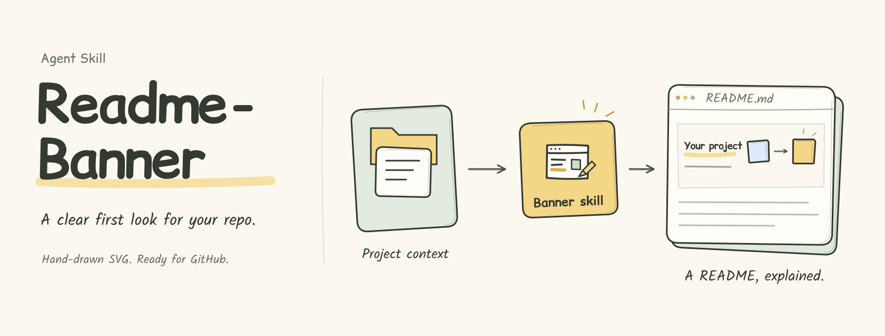

<p align="center"><a href="README.md">中文</a> · <strong>English</strong></p>

# Readme-Banner

Turn a project's purpose into a clear, distinctive SVG at the top of its README. Put a large name and a short promise on the left; use a hand-drawn diagram on the right to explain the inputs, workflow, and useful result.

This Agent Skill reads the project, creates the banner, builds a local preview, and refines it from feedback. The finished SVG embeds directly in a GitHub README without installed fonts, a build step, or remote assets to view it.

## What it does

- **Explains the actual project.** Reads the README, relevant implementation, and existing mark before choosing an input/output flow, grouped diagram, before/after example, or another useful relationship.
- **Keeps the hand-drawn character.** Ivory paper, dark pencil lines, and gentle colors, with rounded upright titles and softer handwritten small text.
- **Preserves the lettering across devices.** Uses Comic Relief / Kalam for English and Xiaolai for explicitly requested Chinese. Published lettering is vector outlines, so missing system fonts cannot change it. Words remain editable in the scene source.
- **Supports preview and revision.** Produces SVG, PNG, and offline HTML; preserves versions for comparison and responds to changes in title hierarchy, icon arrangement, and arrows.
- **Checks README embedding.** Verifies image loading, cropping, and overflow at README and mobile widths. GitHub publication follows the authorization in the current task.

Banner copy defaults to English. Ask explicitly for Chinese or bilingual output when needed. This repository provides both language versions as examples.

## Install

Install the repository in your Agent's skills directory. For the default Codex location, this command works in PowerShell and Bash:

```sh
git clone https://github.com/flyl1u/Readme-Banner.git "$HOME/.codex/skills/readme-banner"
```

If you set `CODEX_HOME`, use its `skills/readme-banner` directory instead. For another Agent that supports `SKILL.md`, use that Agent's skill installation directory.

The folder, internal identifier, and explicit invocation use lowercase `readme-banner`. The display name and natural-language trigger are **Readme-Banner**.

## Use

Ask your Agent from the project directory:

```text
Use Readme-Banner to create an SVG header for this project's README.
Put the project name and a short introduction on the left, with its core workflow on the right.
Generate a local preview first so I can review it before we sync it to GitHub.
```

Or invoke it explicitly:

```text
$readme-banner Create this project's README banner in English and Chinese.
```

Continue with focused revisions:

```text
Make the right diagram slightly smaller and the left title a little larger.
These inputs all use the same skill: arrange the icons in two columns with one shared inlet.
Keep this version, explore one other direction, and show them together for comparison.
```

Multiple alternatives are optional. Start with one direction that explains the project, then preserve and refine versions as needed.

## Deliverables

| File | Purpose |
| --- | --- |
| `hero.svg` | Static, self-contained header for a README |
| `hero.png` | Full-canvas preview |
| `hero-readme.png` / `hero-mobile.png` | Previews at README and mobile widths |
| `preview.html` | Offline viewer with side-by-side comparison and click-to-enlarge |
| `scene.cjs` | Editable source for wording, layout, and artwork |
| `SOURCES.md` / `build-report.json` | Asset provenance, font licensing, and actual verification results |

`hero` is an example filename; the scene ID determines the actual name. The SVG preserves its title, description, and accessible labels. Edit outlined lettering in the source and rebuild it.

## Build locally

SVG and offline HTML generation need only **Node.js 20+**, with no npm packages:

```sh
node scripts/build.cjs assets/readme/scene.cjs --out ../readme-banner-preview --formats svg,html
```

PNG output needs `playwright` with Chrome / Edge / Chromium, or `sharp`. Check the environment and build the full preview with:

```sh
node scripts/build.cjs --doctor
node scripts/build.cjs assets/readme/scene.cjs --out ../readme-banner-preview
node scripts/test_lettering.cjs
```

Browser rendering also checks the actual SVG image for loading and overflow at desktop and mobile widths. Sharp provides raster previews. See [authoring and verification](references/authoring.md), [visual decisions](references/design.md), and [lettering](references/lettering.md).

## Scope and licenses

This skill creates README introduction banners, including previews, revisions, and version comparisons. It does not rewrite entire READMEs, build website heroes, design standalone brand identities, or create slide decks. An Agent icon in a diagram does not establish tested compatibility.

Code and original artwork use the [MIT License](LICENSE). Bundled font outlines retain their respective SIL Open Font Licenses; see [font sources and licensing](assets/lettering/SOURCES.md). The visual references are [CodexPulse](https://github.com/flyl1u/CodexPulse) and [fly-brief](https://github.com/flyl1u/fly-brief), with provenance in the [reference notes](references/sources.md).
