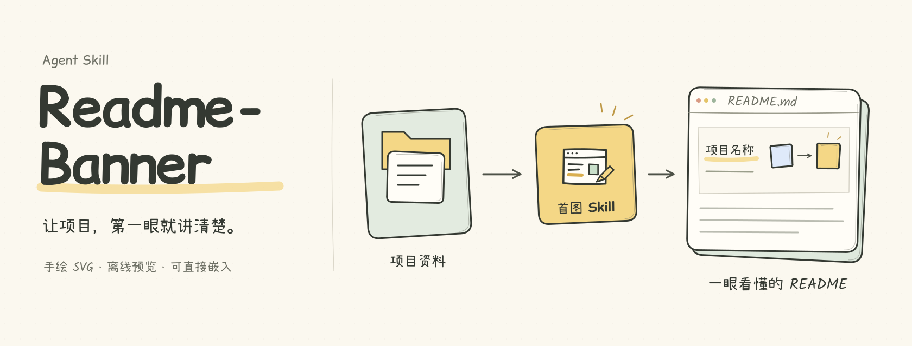
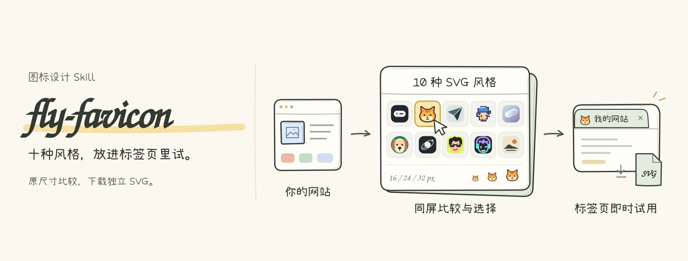
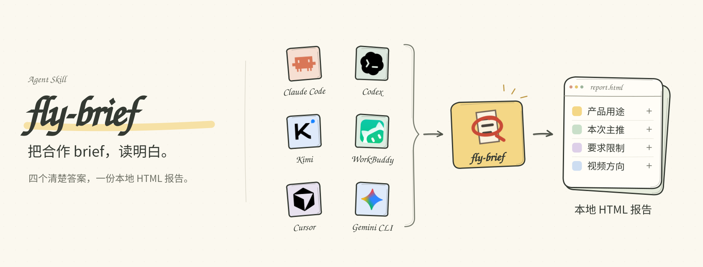
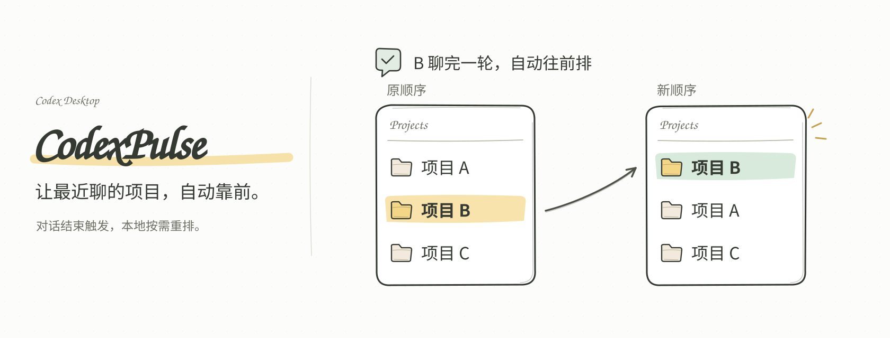

<p align="center"><strong>中文</strong> · <a href="README.en.md">English</a></p>

# Readme-Banner

把项目的用途，变成一张清楚、有辨识度的 README 顶部 SVG。左侧用大标题和一句话介绍项目，右侧用手绘图解释它接收什么、如何工作、产出什么。

这是一个 Agent Skill：负责理解项目、制作首图、生成本地预览，并根据反馈调整。生成的 SVG 可以直接放进 GitHub README，查看时无需安装字体、构建项目或联网加载素材。

## 案例

下面直接展示项目中使用的 SVG，点击图片可查看对应项目。本仓库顶部的介绍图也由 Readme-Banner 制作。

### fly-favicon · 生成案例

从图标设计需求，到多风格候选、对比试用和下载。这张首图使用本 Skill 生成，并经过中英文字体修订。

[](https://github.com/flyl1u/fly-favicon)

### fly-brief · 流程来源

多个 Agent 汇入同一个 Skill，再产出本地 HTML 报告。这张首图的分组、公共入口和比例调整过程，是本 Skill 的原始制作案例与流程来源。

[](https://github.com/flyl1u/fly-brief)

### CodexPulse · 风格参考

用同一个项目在排序前后的变化，解释“最近活跃的项目移到顶部”。这张首图是本 Skill 的早期视觉参考。

[](https://github.com/flyl1u/CodexPulse)

案例 SVG 保留原项目版本，来源与授权见 [案例记录](assets/readme/examples/SOURCES.md)。

## 效果与特点

- **先讲清项目。** 阅读 README、实现和已有图标，再选择输入输出、分组流程或前后对比等合适的图解。
- **保留手绘质感。** 米白纸面、深色铅笔线、柔和配色；左侧大标题和介绍圆润直立，图解注释保留轻松的手写感。
- **字体效果稳定。** 英文使用 Comic Relief / Kalam，明确要求中文时使用小赖字体。发布时把字形转成矢量轮廓，避免换台设备就回退成普通字体；文字仍可在场景源文件中修改。
- **先预览，再修改。** 交付 SVG、PNG 和可离线打开的 HTML；支持保存版本、并排对比，以及按反馈调整标题比例、图标排列和箭头。
- **适合 README。** 检查正常 README 宽度和手机宽度下的加载、裁切与溢出。发布到 GitHub 依照当前任务的授权执行。

默认生成英文首图；需要中文版或双语版本时，请在请求中说明。本仓库首页提供中英两版示例。

## 安装

把下面这段提示词复制给你的 Agent：

```text
请帮我安装 Readme-Banner Skill：
https://github.com/flyl1u/Readme-Banner

阅读仓库中的安装说明与 SKILL.md，安装到当前 Agent 的 Skill 目录。
如果已有旧版本，请保留本地修改后更新。
安装完成后，检查 Skill 是否可以识别，并告诉我如何用 Readme-Banner 调用。
```

## 使用

在项目目录中对 Agent 说：

```text
使用 Readme-Banner，为这个项目制作 README 顶部 SVG。
左边是项目名和一句简短介绍，右边解释项目的核心工作流程。
先生成本地预览，让我看过效果再同步到 GitHub。
```

也可以显式调用：

```text
$readme-banner 为这个项目制作 README 首图，并提供中英两版。
```

继续修改时，可以直接描述目标：

```text
右侧图解稍微缩小，左侧标题再大一点。
这些输入都流向同一个 Skill，把图标重排成两列，用一个公共入口。
保留当前版本，再做一个方向，放在同一页对比。
```

不必每次生成多个方案。默认先完成一个符合项目内容的方向，按需要保留版本并迭代。

## 交付内容

| 文件 | 用途 |
| --- | --- |
| `hero.svg` | 可直接嵌入 README 的静态首图，所有素材均已内嵌 |
| `hero.png` | 完整画布预览 |
| `hero-readme.png` / `hero-mobile.png` | README 和手机宽度预览 |
| `preview.html` | 离线查看、并排比较、点击放大的本地页面 |
| `scene.cjs` | 可继续修改文字、布局与图形的场景源文件 |
| `SOURCES.md` / `build-report.json` | 素材来源、字体授权与实际检查结果 |

`hero` 是示例文件名，实际名称由场景 ID 决定。SVG 内保留标题、描述和文字的无障碍标签；矢量轮廓中的文字请在源文件中修改后重新构建。

## 本地构建

生成 SVG 和离线 HTML 只需要 **Node.js 20+**，无需安装 npm 包：

```sh
node scripts/build.cjs assets/readme/scene.cjs --out ../readme-banner-preview --formats svg,html
```

生成 PNG 时，需要可用的 `playwright` 与 Chrome / Edge / Chromium，或 `sharp`。可以先检查运行环境，再构建完整预览：

```sh
node scripts/build.cjs --doctor
node scripts/build.cjs assets/readme/scene.cjs --out ../readme-banner-preview
node scripts/test_lettering.cjs
```

浏览器渲染会额外检查实际 SVG 图片在桌面和手机宽度下的加载与溢出；Sharp 提供栅格预览。细节见 [编写与构建说明](references/authoring.md)、[视觉判断标准](references/design.md) 和 [字体处理](references/lettering.md)。

## 范围与授权

这个 Skill 用于 README 顶部介绍图，包括预览、迭代和版本对比。它不负责重写整篇 README、制作网站首页、设计独立品牌标志或生成演示文稿。图中出现某个 Agent 的图标，不代表已经完成兼容性测试。

代码与原创图形采用 [MIT License](LICENSE)。字体字形数据采用各自的 SIL Open Font License，见 [字体来源与授权](assets/lettering/SOURCES.md)。风格参考来自 [CodexPulse](https://github.com/flyl1u/CodexPulse) 和 [fly-brief](https://github.com/flyl1u/fly-brief)，来源记录见 [参考说明](references/sources.md)。
